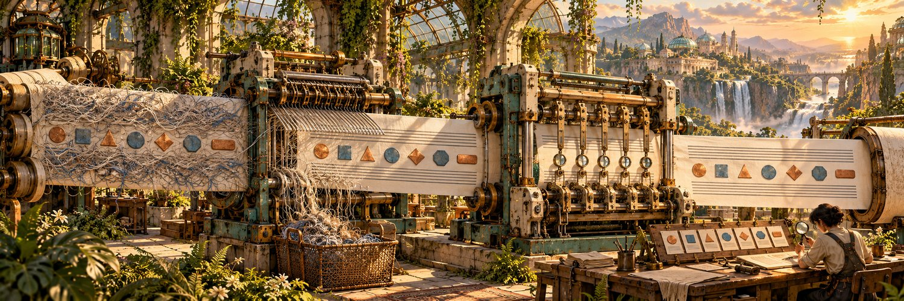

# Hi, I’m kås 👾

I build developer tools, desktop apps, and things that run on tiny hardware.

A few things I’ve been building.

## [Rival](https://github.com/1905/rival)

Independent AI code reviews, running in the background while you work. Browse sessions and findings in your terminal.

Rust · CLI · TUI

[Repository ↗](https://github.com/1905/rival) · [Releases](https://github.com/1905/rival/releases)

## [Stylus](https://github.com/1905/stylus-spotify-mini-player)

A small Spotify player for macOS with built-in playback, a menu-bar player, and a local MCP server for AI control. Requires Spotify Premium.

Rust · Tauri · librespot

[Repository ↗](https://github.com/1905/stylus-spotify-mini-player) · [Download](https://github.com/1905/stylus-spotify-mini-player/releases)

## [neo-md](https://github.com/1905/neo-md)

A native macOS Markdown reader and editor with rendered, source, and split views. Includes live preview, a heading outline, and Quick Look previews in Finder.

Swift · macOS · Markdown

[Repository ↗](https://github.com/1905/neo-md)

## [Lobocode](https://github.com/1905/lobocode)

Run Qwen on a rented GPU from a Mac app. Lobocode provisions the instance, connects over SSH, and serves an OpenAI-compatible API on your computer.

Rust · Tauri · RunPod / Vast.ai

[Repository ↗](https://github.com/1905/lobocode) · [Download](https://github.com/1905/lobocode/releases)

## [Pac-Man on ESP32](https://github.com/1905/pacman-esp32)

The 1980 arcade game recreated for an ESP32-S3, with gamepad support and emulated arcade sound. The same C++ game core also runs on a Mac.

C++ · ESP32-S3 · SDL2 · Educational project

[Repository ↗](https://github.com/1905/pacman-esp32)

## [Holler](https://github.com/1905/holler)

Peer-to-peer messaging for AI agents over Tor. Signed messages, persistent identities, and queued delivery, without a central messaging server.

Go · Tor

[Repository ↗](https://github.com/1905/holler)

## [BooxDrop](https://github.com/1905/booxdrop)

A native macOS file manager for Boox e-readers and Android devices over MTP. Browse and transfer files with the SwiftUI app, or script transfers with the booxcp CLI.

Swift · SwiftUI · MTP

[Repository ↗](https://github.com/1905/booxdrop)

## [Antislop](https://github.com/1905/antislop)

Two agent skills for clear technical writing: controlled English and Russian translation or cleanup, with Go checkers for vocabulary and writing rules.

Go · Agent Skills · Technical writing

[Repository ↗](https://github.com/1905/antislop)

## [Bitreel](https://github.com/1905/go-bitreel)

Encode a file as video, then decode it back. Represents file data as black-and-white pixel blocks and uses FFmpeg to create the video.

Go · FFmpeg

[Repository ↗](https://github.com/1905/go-bitreel)

## [Pentimento](https://github.com/1905/go-pentimento)

An experimental image steganography project in Go. Hide encrypted data inside images and extract it again, while exploring least-significant-bit techniques.

Go · Steganography · Experimental

[Repository ↗](https://github.com/1905/go-pentimento)

## [Pow Jabbar](https://github.com/1905/powjabbar)

Proof-of-work challenges for HTTP services. Clients perform the computation; the server checks self-contained, signed challenges.

Go · HTTP · Proof of work

[Repository ↗](https://github.com/1905/powjabbar)
